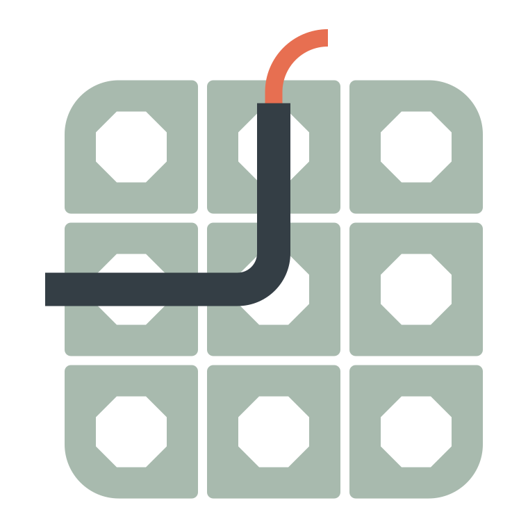
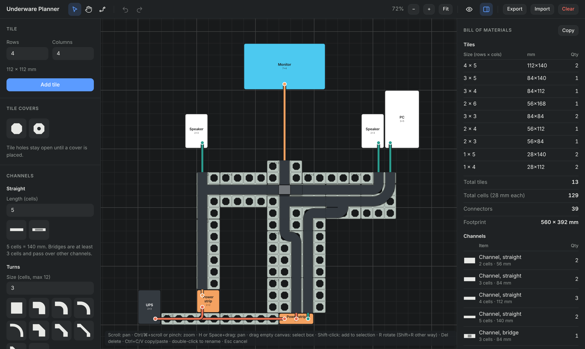

<p align="center"></p>

# Underware Planner

A browser-based planner for cable management on openGrid — the 28 mm tile system for wall and desk organisation. Lay out your tiles, devices, channels and cables on an infinite canvas, and get a bill of materials of every part you need to print or buy.

Everything runs client-side. There is no backend and no account; your layout autosaves in the browser and can be exported as JSON.

**Try it:** https://mars-3dprints.github.io/underware-planner/



## What it does

- **Plan the layout.** Place openGrid tiles, your own devices, cable channels and tile covers on a Figma-style infinite canvas. Everything snaps to the 28 mm grid (1 cell = 28 mm).
- **Route cables.** Draw a cable between two objects and it auto-routes orthogonally around obstacles on the grid, using the fewest bends. Add waypoints to steer it, or leave an end loose.
- **Cover cables with channels.** Channels are drawn over the cables they carry, so you can see exactly where cables are hidden and where they are exposed. Turn on see-through mode (**P**) to look at the cables underneath.
- **Cables follow the channels.** Where a cable runs inside a shaped channel it follows that piece's real centerline (turn radius, diagonal, S-curve, junction arc). Outside channels it keeps the orthogonal look, and it falls back on its own if the channel is moved or removed.
- **Focus with layers.** Show or hide tiles, objects, channels and cables independently, for example to look at just the tile plan.
- **Count the parts.** A live bill of materials tracks tiles by size, connectors, each channel type, tile covers and total cable length, with a separate line for each colour (custom objects are your own devices, so they aren't counted). Leave out parts you already have by unticking **Include in bill of materials** for the selection; they're shown faded.

## Parts

**Tiles** — any rows × columns. The BOM counts tiles per size (orientation-independent), total cells, and the connectors needed where tiles touch.

**Custom objects** — any footprint, named and resizable (a router, a power strip, a monitor…). Presets are included for common devices.

**Channels**

| Group | Parts |
| --- | --- |
| Straight | Straight (any length), bridge (min. 3 cells, passes over other channels) |
| Turns | Rounded and angled turns (resizable, 1–12 cells), short turn (open on two sides, no arm), plus its mirrored version |
| Merge and branch | Rounded and angled, plus the mirrored versions |
| Junctions | 3-way, 4-way (3×3), compact 4-way (1×1), inline 3-way and 4-way (3×1, openings in the side walls), end 3-way (2×1), rounded and angled forks |
| Offsets | Rounded and angled, plus the mirrored versions |

Mirrored parts are different prints, so they are listed as separate BOM entries. Overlapping channels are flagged with a dashed red outline. Turns, merges, offsets and forks each come in a rounded and an angled form; press **T** (or use the toolbar button) to switch a selected part, or the part you are placing, between them.

**Tile covers** — cover, wall mount and Multiconnect (a bigger, threaded hole). Tile holes stay open until a cover is placed.

**Cables** — length is cells × 28 mm plus optional extra slack. Cables have their own colour, name and slack setting and are listed with their lengths in the BOM.

## Using it

- **Place a part:** pick it in the left panel, move the cursor to position the ghost, and click to place. Changes to name, size or colour show on the ghost straight away and keep its rotation. Esc or right-click stops placing.
- **Draw a cable:** press **C**, click an object (or an empty cell for a loose end), click empty cells for waypoints, then click another object to finish. Select a cable and drag its line to add waypoints, or drag a handle to move it.
- **Inspect shared paths:** hover a path to list every cable running there while the rest fade, however many overlap. Hover a cable in the right-hand list to trace its route, or select an object to see the cables connected to it. Each cable is labelled with the objects it connects, such as `Router ↔ NAS`.
- **Stack cables:** drag cables in the right-hand list to reorder them. Cables lower in the list are drawn on top.
- **Select:** click, shift-click to add, or drag a box on empty canvas. Move, rotate, flip, copy, duplicate, recolour and delete work on the whole selection, including cables.
- **Colour:** the toolbar colour button recolours the current selection. A default palette is always available, and you can add your own colours.
- **Undo and redo** select the parts they changed.
- **Nudge:** arrow keys move the selection by one cell (Shift: five).
- **Layers:** the layers button (or **1–4**) shows or hides tiles, objects, channels and cables. Hidden layers can't be selected, and placing a part shows its layer again. The bill of materials still counts hidden parts.
- **See through:** the eye button (or **P**) draws channels at 75 % opacity.
- **Sidebar:** the toolbar button (or **\\**) hides or shows the bill-of-materials panel.

### Shortcuts

| Key | Action |
| --- | --- |
| V / H / C | Select / Pan / Cable tool |
| Space + drag, middle-drag, scroll | Pan |
| Ctrl/⌘ + scroll, pinch | Zoom |
| 0 | Fit to content |
| R / Shift+R | Rotate clockwise / counter-clockwise |
| F | Flip (shaped channels) |
| T | Switch rounded / angled |
| P | See through channels |
| \\ | Show / hide the sidebar |
| 1 / 2 / 3 / 4 | Toggle layers: tiles / objects / channels / cables |
| Arrow keys / Shift+arrows | Nudge selection by 1 / 5 cells |
| Ctrl+A / C / V / D | Select all / copy / paste / duplicate |
| Del | Delete (or delete the selected cable point) |
| Ctrl+Z / Ctrl+Shift+Z | Undo / redo |
| Esc | Cancel |

## Saving and sharing

The layout autosaves to `localStorage` (key `underware-planner-v1`), separately for each site: a layout saved locally doesn't appear on the hosted version, so move it with Export and Import. **Export** downloads `underware-layout.json`; **Import** loads one back. **Copy** in the bill of materials puts a plain-text parts list on your clipboard.

## Related projects

This planner is an unofficial companion to these MakerWorld models:

- [openGrid](https://makerworld.com/en/models/1179191-opengrid-wall-desk-mounting-framework-ecosystem#profileId-1190225): the wall and desk mounting framework the tiles come from.
- [Underware for openGrid](https://makerworld.com/en/models/1175037-underware-for-opengrid): the cable channels this planner lays out.

## Contributing

Issues and pull requests are welcome. See [CONTRIBUTING.md](CONTRIBUTING.md).

## Changelog

See [CHANGELOG.md](CHANGELOG.md).

## Development

Requires Node 22.12 or later (`.nvmrc` pins 22).

```sh
npm install
npm run dev           # http://localhost:5173
npm run build         # typecheck + production build into dist/
npm run preview       # serve the production build at /underware-planner/
npm test              # unit tests (Vitest)
npm run lint          # ESLint
npm run format        # Prettier
npm run check         # typecheck, lint, format check and tests
```

### Deployment

The site always shows the latest release, not `main`. When a release is published (see below), the Release workflow deploys it with `.github/workflows/deploy.yml`: checks, build, then publish `dist/` to GitHub Pages. To redeploy the latest release, run the Deploy workflow by hand. Builds use the base path `/underware-planner/` (`vite.config.ts`); change it if the repo is renamed or moved to a custom domain.

### Releases

Versions are released by bumping them on `main`: move the `[Unreleased]` changelog entries under `## [X.Y.Z] - YYYY-MM-DD`, run `npm version X.Y.Z --no-git-tag-version`, and commit `chore: bump version to X.Y.Z`. When that reaches `main`, `.github/workflows/release.yml` tags the bump commit `vX.Y.Z` and publishes a GitHub Release with that changelog section as its notes. The app shows its version next to its name: `vX.Y.Z` on the site (built with `--mode release`), `vX.Y.Z+dev` in any other build.

Stack: React 19, TypeScript, [zustand](https://github.com/pmndrs/zustand) and Vite. The canvas is plain SVG.

### Project layout

Pure logic (no React) is in `domain/`, `routing/` and `bom/`, with unit tests next to it. React code is in `features/`, `app/` and `ui/`.

| Path | Responsibility |
| --- | --- |
| `src/domain/` | Part model: types, piece catalogue (shapes, openings, labels), geometry, layout edits, group move/rotate/clone, save migration |
| `src/routing/` | Cable auto-routing (A* on the grid) and cables following channel shapes |
| `src/bom/` | Bill of materials and overlap detection |
| `src/store/` | App state (zustand), undo/redo history, autosave, view helpers (fit, zoom) |
| `src/features/canvas/` | Infinite canvas: part and cable rendering, selection overlay, pointer and keyboard input |
| `src/features/panels/` | Left panel (parts to place) and right panel (selection, bill of materials, cables) |
| `src/app/` | App shell, toolbar, layers menu, keyboard shortcuts, import/export |
| `src/ui/` | Shared components: icons, buttons, part thumbnails, colour swatches |
| `src/styles/` | Styles and light/dark theme tokens |
| `src/test/` | Test fixture layout |

## License

[MIT](LICENSE)
